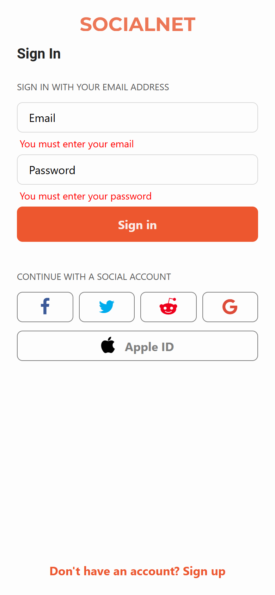
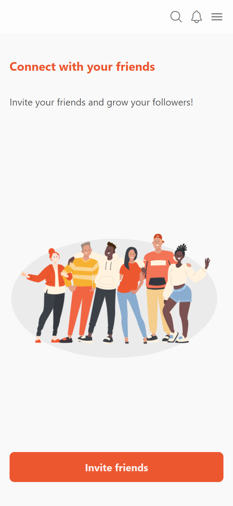
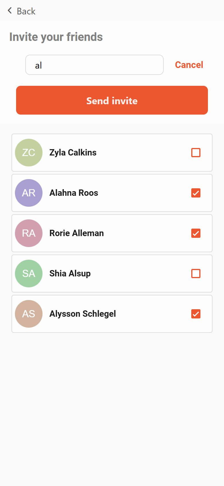
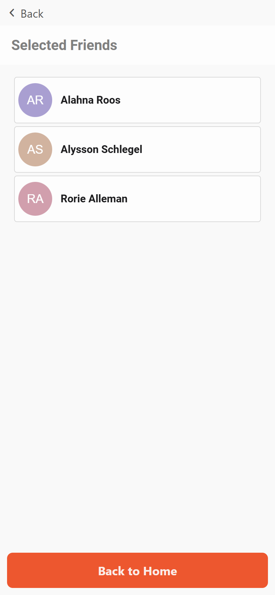

# Socialnet — React Native coding challenge

> **Archived.** A take-home coding challenge from 2023, kept as a snapshot of that work.
> It targets Expo SDK 48 and is not maintained.

A five-screen onboarding flow for a fictional social network, built with Expo and React
Native from a design mockup. There is no backend: sign-in only validates the form, and the
friends list is static data.

## Flow

1. **Welcome** — full-bleed background image, logo and a *Get Started* call to action.
2. **Sign in** — email and password fields with per-field required validation; the error
   clears as soon as the field changes. Social login buttons are visual only.
3. **Home** — header, illustration and an *Invite friends* call to action.
4. **Invite friends** — searchable, case-insensitive list with multi-select checkboxes.
   Avatars are loaded from `picsum.photos`, so they need network access.
5. **Confirm** — the friends selected on the previous screen, passed as a navigation param.

## Screens

<table>
  <tr>
    <td></td>
    <td></td>
    <td></td>
    <td></td>
    <td></td>
  </tr>
  <tr>
    <td align="center">Welcome</td>
    <td align="center">Sign in</td>
    <td align="center">Home</td>
    <td align="center">Invite friends</td>
    <td align="center">Confirm</td>
  </tr>
</table>

## Stack

- Expo SDK 48, React Native 0.71, React 18
- React Navigation 6 (native stack), `expo-checkbox`, `@expo/vector-icons`
- ESLint (Airbnb config + React Native plugin) and Prettier

## Structure

```
App.js                  Navigation stack and global layout
src/
  welcome/              Welcome screen
  signIn/               Sign-in form and validation
  home/                 Home screen
  inviteFriends/        Searchable multi-select list
  confirmFriends/       Selected friends summary
  components/           Button, header, friend row, social icon
  consts.js             Brand colors
assets/                 Logos, background, illustration
```

## Running it

The project pins Expo SDK 48, which current Expo Go releases no longer load. To run it, use
an Android emulator or device with an Expo Go build that supports SDK 48, then:

```bash
npm install
npm start        # expo start; press "a" for Android
```
